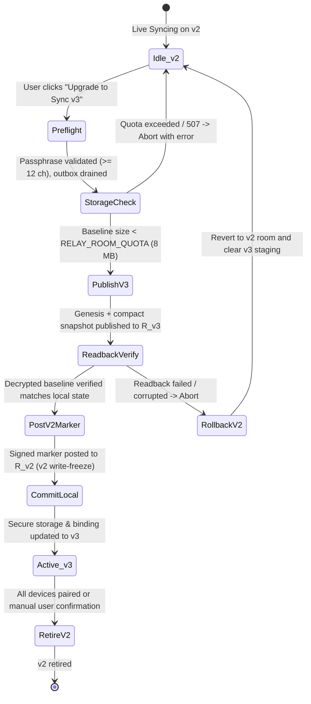

# Sync Key & Room Derivation v3: Migration & Hardening Design

> **Status:** Proposal / Design Specification (Design only — no implementation without owner approval)  
> **Target Release:** Cognate 3.2.0  
> **Related Architecture:** [docs/ARCHITECTURE.md](ARCHITECTURE.md), [docs/RELAY.md](RELAY.md), [docs/BENCHMARKS.md](BENCHMARKS.md)

---

## 1. Threat Model & Entropy Analysis

### 1.1 Vulnerability in Protocol v2 Key Derivation
In the current implementation (`src/services/crypto.ts`), `deriveSyncKey` uses static salt `'cognate-sync-key-v2'` and `deriveRoomId` uses static salt `'cognate-sync-room-v2'`. Because salts are hardcoded and global:
1. **Offline Multi-Target Dictionary Attacks**: An attacker obtaining a relay database snapshot can run GPU dictionary attacks against all rooms simultaneously.
2. **Deterministic Cross-Tenant Collisions**: Two independent users choosing the same passphrase derive the identical 32-character room ID on the relay.
3. **Residual Risk on Historical v2 Data**: Because v2 rooms are immutable and currently have no deletion endpoint on the relay, an attacker holding a relay database backup can attack historical v2 blobs even after a client migrates to v3 unless the v2 room is explicitly retired or wiped.

### 1.2 Entropy & Representation Table
Every workspace generates 128 bits of true entropy ($S$) via CSPRNG (`crypto.getRandomValues(new Uint8Array(16))`).

| Representation | Format | Bits | Collision Probability ($N = 10^9$) | Offline Brute-Force ($10^{12}$ guesses/s) |
|---|---|---|---|---|
| **Raw Bytes** (QR / Recovery Kit) | 16 raw octets (`Uint8Array(16)`) | 128 | $P \approx \frac{N^2}{2^{129}} \approx \frac{10^{18}}{6.806 \times 10^{38}} \approx 1.47 \times 10^{-21}$ | $2^{128} \approx 3.403 \times 10^{38}$ attempts $\to 1.078 \times 10^{19}$ years |
| **Manual Code** (Crockford Base32) | 26 payload symbols + 1 check symbol | 128 | Same ($128$ bits entropy $+ 2$ zero pad bits) | Same ($1.078 \times 10^{19}$ years) |
| **Encrypted Recovery Kit** | 16 raw octets in `PasswordBlob` | 128 | Same | Same |

*Arithmetic*:
- Collision probability by Birthday bound: $P(N) \approx 1 - \exp\left(-\frac{N^2}{2 \cdot 2^{128}}\right) \approx \frac{N^2}{2^{129}}$. For $N = 10^9$ workspaces: $\frac{(10^9)^2}{2 \times 3.4028 \times 10^{38}} = 1.469 \times 10^{-21}$.
- Brute-force time: $\frac{2^{128}}{10^{12} \text{ tries/s}} = \frac{3.4028 \times 10^{38}}{10^{12} \times 3.15576 \times 10^7 \text{ s/yr}} = 1.078 \times 10^{19}$ years.

### 1.3 Threat Mitigation Matrix

| Threat Vector | Protocol v2 (Current) | Protocol v3 (New Data) | Protocol v3 (Existing Historical v2 Data) |
|---|---|---|---|
| **Relay DB Compromise (Dictionary Attack)** | High Risk: global static salt allows pre-computation / multi-target attacks | Fully Mitigated: 128-bit per-room setup salt renders rainbow tables impossible | **Residual Risk**: Historical v2 room remains vulnerable until retired / wiped on relay |
| **Cross-Tenant Room Collision** | Medium Risk: identical passphrase produces identical room ID | Eliminated: $P < 1.47 \times 10^{-21}$ for $10^9$ workspaces | v2 room retains existing collision risk |
| **Relay Traffic Eavesdropping** | Room ID leaked; allows targeted passphrase guessing | Room ID requires knowing both $P$ and $S$ | v2 room ID remains linkable |
| **Shoulder Surfing / Display Capture** | Attacker sees passphrase | Attacker only sees QR / Setup Code $S$; still lacks $P$ | No impact |

---

## 2. Setup Code & Crockford-32 Specification

### 2.1 Alphabet & Permissive Decoding
- **Encoding Alphabet** (32 symbols): `0 1 2 3 4 5 6 7 8 9 A B C D E F G H J K M N P Q R S T V W X Y Z` (omits `I`, `L`, `O`, `U`).
- **Bit Packing**: 16 raw bytes (128 bits) are padded with two zero bits to 130 bits, yielding exactly 26 five-bit symbols ($26 \times 5 = 130$).
- **Decoding Rules**:
  - Case-insensitive (lowercase mapped to uppercase).
  - Hyphens (`-`) and spaces are ignored.
  - Permissive canonical alias mapping: `O` and `o` $\to$ `0`; `I`, `i`, `L`, `l` $\to$ `1`.
  - `U` and `u` are rejected during decoding to prevent accidental profanity.

### 2.2 Modulo-37 Check Symbol
Douglas Crockford's Modulo-37 check symbol detects all single-character substitutions and all adjacent transpositions.
- **Algorithm**: Evaluate the 26 base-32 digits as a big-endian integer modulo 37:
  $$r_0 = 0, \quad r_{i+1} = (r_i \times 32 + d_i) \pmod{37} \quad \text{for } i \in [0, 25]$$
- **Symbol Lookup for Remainder $r \in [0, 36]$**:
  - Values $0 \le r \le 31$: standard alphabet symbol `0`..`Z`.
  - Values $32 \le r \le 36$: `*` (32), `~` (33), `$` (34), `=` (35), `U` (36).
- **Formatting**: 26 payload characters + 1 check character grouped as 6 groups of 4 plus 3: `XXXX-XXXX-XXXX-XXXX-XXXX-XXXX-XXX`.

### 2.3 Worked Known-Answer Test Vectors

1. **Zero Vector** (16 bytes `0x00`):
   - Raw: `00000000000000000000000000000000`
   - Base32: `00000000000000000000000000`
   - Mod-37 remainder: $r = 0 \to$ check symbol `0`
   - Formatted: `0000-0000-0000-0000-0000-0000-000`
2. **All-Ones Vector** (16 bytes `0xFF`):
   - Raw: `ffffffffffffffffffffffffffffffff`
   - Base32: `ZZZZZZZZZZZZZZZZZZZZZZZZZW` (last symbol has 2 trailing zero pad bits: `11100` = 28 = `W`)
   - Mod-37 remainder: $r = 17 \to$ check symbol `H`
   - Formatted: `ZZZZ-ZZZZ-ZZZZ-ZZZZ-ZZZZ-ZZZZ-ZWH`
3. **Sequential Vector** (16 bytes `0x01` through `0x10`):
   - Raw: `0102030405060708090a0b0c0d0e0f10`
   - Base32: `041061050R3GG28A1C60T3GF20`
   - Mod-37 remainder: $r = 30 \to$ check symbol `X`
   - Formatted: `0410-6105-0R3G-G28A-1C60-T3GF-20X`

---

## 3. Key Derivation Architecture (Single PBKDF2 + HKDF-SHA256)

To eliminate the $3\times$ latency of calling 600,000 PBKDF2 iterations thrice, v3 performs a single slow stretch to produce a master secret, then expands keys via RFC 5869 HKDF-SHA256.

```
Passphrase P (NFKD, trimmed)
         │
         ▼
PBKDF2-SHA256 (600,000 iters) ── Salt: "cognate-v3:" || 0x10 || SetupCode[16]
         │
         ▼
Master Secret M (256 bits PRK)
         │
         ├─► HKDF-Expand(info="cognate-sync-key-v3", 32) ──► K_v3 (AES-256-GCM)
         ├─► HKDF-Expand(info="cognate-sync-room-v3", 32) ─► R_v3 (First 32 hex chars)
         └─► HKDF-Expand(info="cognate-sync-verifier-v3", 16) ─► C_v3 (32 hex chars)
```

### 3.1 Derivation Parameters & Byte Encodings
- **Salt**: ASCII prefix `cognate-v3:` (11 bytes) $\mathbin{\Vert}$ length byte `0x10` (1 byte) $\mathbin{\Vert}$ raw 16-byte Setup Code $S$ = 28 octets total.
- **Master Secret ($M$)**: $\text{PBKDF2-SHA256}(P, \text{Salt}, 600000, 32 \text{ bytes})$.
- **HKDF-SHA256 Expansion**:
  - $K_{v3}$: $\text{HKDF-Expand}(M, \text{"cognate-sync-key-v3"}, 32) \to$ 256-bit AES-GCM `CryptoKey`.
  - Room ID $R_{v3}$: $\text{HKDF-Expand}(M, \text{"cognate-sync-room-v3"}, 32) \to$ first 16 bytes encoded as 32 lowercase hex characters.
  - Genesis Verifier $C_{v3}$: $\text{HKDF-Expand}(M, \text{"cognate-sync-verifier-v3"}, 16) \to$ 16 bytes encoded as 32 lowercase hex characters.

### 3.2 Performance & UI Impact
- **Benchmark Estimate**: 600,000 iterations of PBKDF2-SHA256 take 350–550 ms on a desktop CPU (Apple M-series / Intel i7) and 1.2–1.8 s on low-end mobile. HKDF-Expand takes $< 1$ ms.
- **Main Thread Isolation**: WebCrypto (`crypto.subtle`) runs PBKDF2 on background browser worker threads; it does not block React UI rendering. A standard indeterminate progress spinner is displayed during computation.

### 3.3 Known-Answer Test Vector (KAT)
- **Input Passphrase**: `correct horse battery staple`
- **Input Setup Code**: `0102030405060708090a0b0c0d0e0f10`
- **Expected Outputs**:
  - Master Secret ($M$): `64d28da6b43e213c1479ac959aa8761c20156c179b669514f7fa7b76c2ecf288`
  - AES Key ($K_{v3}$): `b9b73b7fb6a7389e1c94186de6f63d25ee217ff76e135678951af4947db15057`
  - Room ID ($R_{v3}$): `af340eac1d2451afe20f762a4a8cb695`
  - Genesis Verifier ($C_{v3}$): `3cf82af26a2bdad2b0e0aa78f6bb1166`
  - Ciphertext with zero IV (`12` zero bytes, payload `{"genesis":true}`):
    - Ciphertext: `0e2209e87b9dcb2fa8d6ed3bc8aaa7be`
    - GCM Tag: `d8dc956bb905c44e6e95319a97953397`

---

## 4. Passphrase Policy & Justification

### 4.1 Canonical Validation Policy
1. **Normalization**: Unicode Normalization Form KD (`NFKD`) applied before length check, validation, and key derivation.
2. **Whitespace**: Leading and trailing whitespace is stripped via `trim()` to prevent copy-paste artifacts; internal whitespace (spaces, tabs) is preserved.
3. **Length Count**: Counted strictly in Unicode scalar values / code points (`[...normalized].length >= 12`).
4. **Complexity / Entropy**:
   - Rejects single-character repeated strings ($\ge 4$ unique code points required).
   - Rejects exact matches against top 10,000 common passwords.
   - *Bundle-Size Decision*: A compact 10k Bloom filter / hash set ($\approx 25$ KB) is used instead of heavy packages like `zxcvbn` ($\approx 400$ KB).
5. **No Retroactive Invalidation**: Existing v2 workspaces are not blocked from continuing v2 sync with short passphrases. When initiating a v3 migration, if the existing passphrase is $< 12$ code points, the user must update it to $\ge 12$ code points before migration proceeds.

### 4.2 Why Passphrase Remains Mandatory with 128-bit Setup Code
The Setup Code is a **possession factor** (rendered on screen as a QR code or printed). If an attacker photographs the screen, inspects an unencrypted export, or compromises the clipboard, the passphrase serves as the essential **knowledge factor** (two-factor confidentiality). Requiring both prevents optical eavesdropping from immediately compromising workspace read/write authority.

---

## 5. Workspace Genesis vs. Join Semantics

To prevent an incorrect passphrase or setup code from silently creating and syncing to an empty room, workspace creation and workspace joining have distinct semantics.

### 5.1 Workspace Creation (Originating Device)
1. Derives $K_{v3}, R_{v3}, C_{v3}$.
2. Compiles a signed `v: 3` genesis batch (Batch ID `genesis`, Cursor 1) containing:
   - Verifier ciphertext: AES-GCM encryption of `{"verifier": C_v3, "workspace_id": UUID}`.
   - Initial compact snapshot (squashed state of tasks, projects, actor identity, and HLC clock anchor).
3. Posts genesis batch to `PUT /v2/rooms/{R_v3}/batches/genesis`.

### 5.2 Workspace Joining (Second Device)
When a user selects "Join Existing Workspace" on Device 2:
1. Inputs Relay URL, Setup Code $S$, and Passphrase $P$.
2. Computes candidate $K_{v3}', R_{v3}', C_{v3}'$.
3. Fetches genesis batch: `GET /v2/rooms/{R_v3}'/batches?after=0`.
4. **Validation Pipeline**:
   - **Step 1 (Existence)**: If room returns 0 batches (cursor 0), **fail immediately** with `"No workspace found for this Setup Code and Passphrase"`. Joining **never** auto-creates a room.
   - **Step 2 (Decryption)**: Decrypt batch 1 with candidate $K_{v3}'$. If GCM tag check fails, **fail immediately** with `"Incorrect Passphrase"`.
   - **Step 3 (Verifier Check)**: Verify decrypted `verifier === C_v3'`. If mismatch, **fail immediately**.
   - **Step 4 (Identity & Signature)**: Verify ECDSA signature of genesis batch against embedded creator public key.
5. Commit local sync configuration only after Steps 1–4 succeed.

---

## 6. Migration State Machine & Rollback



### 6.1 State Machine Ordering & Crash Recovery
1. **Pre-flight & Storage Check**:
   - Ensure local outbox is drained (no unacknowledged v2 batches).
   - Compute squashed snapshot baseline. Size is checked against `RELAY_ROOM_QUOTA` (8 MB). A squashed baseline is typically 50–200 KB, avoiding journal limit exhaustion.
2. **Publish & Readback Verification**:
   - Publish genesis and baseline batches to $R_{v3}$.
   - **Strict Verification Step**: Device fetches batches back from $R_{v3}$ via HTTP, decrypts with $K_{v3}$, and validates signatures. The migration does **not** proceed unless readback passes.
3. **Post Migration Marker to v2**:
   - Write signed batch to $R_{v2}$ containing `{ type: "MIGRATION_MARKER", target_room: R_v3, migrated_at: timestamp, actor: id }`.
   - **Crucial**: The marker carries **zero key material** and zero setup code bytes.
4. **Local Atomic Commit**:
   - Persist Setup Code to secure storage (`sync_setup_code`).
     - **Desktop**: OS Keychain via Rust `keyring` crate commands (`secret_set`).
     - **Browser**: AES-GCM encrypted in IndexedDB via `browserVault`.
   - Update `sync_workspace_binding` to `{ version: 3, room: R_v3, v2_fallback: { room: R_v2 } }`.

### 6.2 Split-Brain & Concurrency Resolution
- **Tiebreak**: If two devices concurrently migrate, both attempt to post a migration marker to $R_{v2}$. The relay's monotonic cursor determines the winner: **the migration marker with the lower cursor wins**.
- **Loser Behavior**: The losing device sees the winner's earlier marker when pulling $R_{v2}$, aborts its uncommitted v3 room, and prompts the user to adopt the winner's setup code.
- **v2 Write-Freeze**: Any client encountering a migration marker in $R_{v2}$ enters read-only mode for v2 and refuses to post further v2 batches.
- **Sunset Window**: Un-migrated v2 devices have a 30-day grace period to pair to v3 before v2 retirement.

---

## 7. Decisions Needed from Owner

### Decision 1: v2 Room Deletion vs. Relay Wire-Format Non-Goal
- **Conflict**: Relay batches are currently immutable and there is no room deletion endpoint. Without deletion, historical v2 ciphertext remains on the relay, susceptible to offline dictionary attacks if the relay database is breached.
- **Options**:
  - **Option A (Recommended — Minimal Relay Route)**: Add `DELETE /v2/rooms/{room}` authenticated by an owner-signed retirement marker or bearer token. Reclaims the 8 MB room quota and global 32 MB store limit, and purges vulnerable historical ciphertext.
  - **Option B (Strict Non-Goal Preservation)**: Keep relay unchanged. Document residual risk: operators must manually purge old relay data, and historical v2 ciphertext remains on the relay indefinitely.
  - **Option C (Client Tombstone)**: Post a tombstone batch that soft-deletes the room at the application layer, but leaves underlying ciphertext in `relay.json`.
- **Recommendation**: **Option A**. A 15-line addition to `server/src/main.rs` eliminates the residual risk and prevents dead storage exhaustion under the 32 MB store cap.

### Decision 2: v2 Room Retirement Trigger
- **Options**:
  - **Option A (Automatic)**: Automatically retire $R_{v2}$ once all previously active actor keys have synced at least one batch to $R_{v3}$ or after 30 days.
  - **Option B (Manual Confirmation — Recommended)**: Keep $R_{v2}$ read-only until the user explicitly clicks "Retire Old Sync Room" in Settings, preventing premature deletion if an offline device has not yet paired.

### Decision 3: Mandatory vs. Optional Passphrase
- **Options**:
  - **Option A (Mandatory — Recommended)**: Retain $\ge 12$ character passphrase as a mandatory second factor alongside the 128-bit Setup Code. Defends against display capture, shoulder surfing, and physical QR code theft.
  - **Option B (Optional)**: Allow passphrase to be empty, deriving keys solely from the 128-bit Setup Code. Reduces user friction but reduces security to single-factor possession.

---

## 8. Test Plan

1. **Crockford-32 Encoding & Normalization**:
   - Verify encoding of all-zeros, all-ones, and sequential test vectors against Section 2.3.
   - Verify Modulo-37 check symbol generation and detection of swapped adjacent characters and single-character substitutions.
   - Verify decoding normalizes lowercase, strips hyphens/spaces, maps `O` $\to$ `0`, `I`/`L` $\to$ `1`, and rejects `U`.
2. **KDF & Cryptographic Test Vectors**:
   - Verify KAT vectors from Section 3.3 for Master Secret, $K_{v3}$, $R_{v3}$, $C_{v3}$, and AES-GCM ciphertext/tag.
3. **Genesis vs. Join Semantics**:
   - Verify joining a non-existent room fails with `"No workspace found"` without creating a room.
   - Verify wrong passphrase produces decryption tag error.
   - Verify verifier mismatch error on mismatched candidate.
4. **Migration & State Machine**:
   - Test pre-flight check aborts on relay 507 quota error without touching v2 room.
   - Test readback verification failure triggers rollback before v2 marker is written.
   - Test crash/kill simulation at each migration journal step resumes idempotently.
   - Test concurrent migration tiebreak: lowest v2 cursor wins; loser reverts.
   - Test v2 write-freeze blocks writes once migration marker is visible.
5. **Backward Compatibility**:
   - Verify existing v1 and v2 test vectors in `src/services/relayService.test.ts` and `src/services/crypto.test.ts` remain decryptable.
