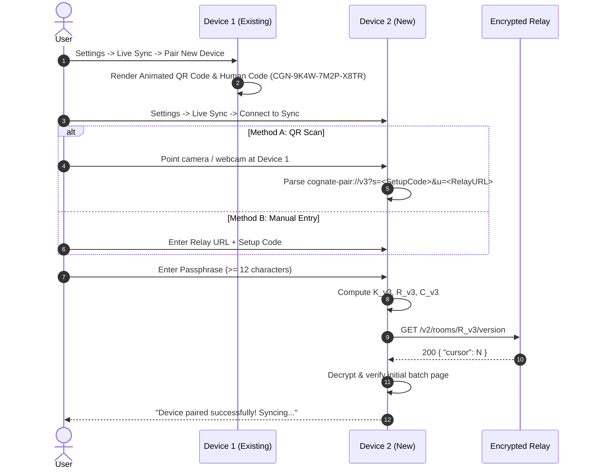
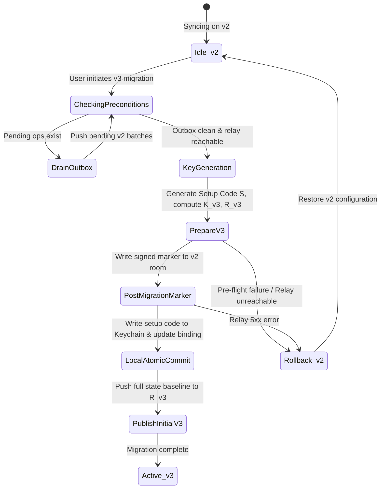

# Sync Key & Room Derivation v3: Migration & Hardening Design

> **Status:** Proposal / Design Specification (No code implementation until approved)  
> **Target Release:** Cognate 3.2.0  
> **Related Architecture:** [docs/ARCHITECTURE.md](ARCHITECTURE.md), [docs/RELAY.md](RELAY.md), [docs/BENCHMARKS.md](BENCHMARKS.md)

---

## 1. Executive Summary & Problem Statement

### 1.1 Vulnerability in Protocol v2 Key Derivation
In the current implementation (`src/services/crypto.ts`):
```typescript
// v2 key derivation:
export async function deriveSyncKey(passphrase: string): Promise<CryptoKey> {
  const base = await subtle().importKey('raw', enc.encode(passphrase), 'PBKDF2', false, ['deriveKey']);
  return subtle().deriveKey(
    { name: 'PBKDF2', salt: enc.encode('cognate-sync-key-v2'), iterations: 600000, hash: 'SHA-256' },
    base,
    { name: 'AES-GCM', length: 256 },
    false,
    ['encrypt', 'decrypt']
  );
}

// v2 room derivation:
export async function deriveRoomId(passphrase: string): Promise<string> {
  const base = await subtle().importKey('raw', enc.encode(passphrase), 'PBKDF2', false, ['deriveBits']);
  const digest = await subtle().deriveBits(
    { name: 'PBKDF2', salt: enc.encode('cognate-sync-room-v2'), iterations: 600000, hash: 'SHA-256' },
    base,
    256
  );
  return toHex(digest).slice(0, 32);
}
```

This presents three critical security and operational risks:
1. **Global Static Salt Vulnerability**: The salts `'cognate-sync-key-v2'` and `'cognate-sync-room-v2'` are static and identical across all Cognate installations worldwide. An adversary who intercepts relay traffic or compromises a public/self-hosted relay database can compile multi-target rainbow tables or utilize specialized GPU clusters to mount parallel dictionary attacks against all rooms simultaneously.
2. **Deterministic Cross-Tenant Room Collision**: If two independent Cognate users select the same passphrase (e.g. standard dictionary phrases or common passwords), they derive the exact same 32-character room ID on the relay, colliding and potentially overwriting or attempting to decrypt each other's batches.
3. **No Minimum Passphrase Length on Sync**: While backup recovery export enforces 12 characters in `src/services/recoveryService.ts`, `relayService.enableSync(url, passphrase)` accepts arbitrary passphrases of any length without validation.

### 1.2 Proposed Resolution (Protocol v3)
Introduce a **128-bit cryptographically secure, high-entropy Setup Code** generated per workspace that is combined with a **mandatory minimum 12-character user passphrase** to derive isolated, collision-free relay room IDs and workspace encryption keys.

---

## 2. Cryptographic Specification (v3)

### 2.1 Entropy & Key Derivation Functions
- **Setup Code ($S$)**: 128 bits of cryptographically secure random bytes generated via `crypto.getRandomValues(new Uint8Array(16))`.
  - Wire/storage representation: Hex string (32 chars) or Crockford Base32.
  - Human-facing representation: 4 groups of 4 characters (`CGN-XXXX-XXXX-XXXX`), Crockford Base32 alphabet (omitting `I`, `L`, `O`, `U` to prevent transcription errors), with an embedded Luhn-mod-32 check digit.
- **Passphrase ($P$)**: UTF-8 string, normalized under Unicode NFKD, strictly validated with $\ge 12$ characters.

```
                    ┌───────────────────────────┐
                    │  Passphrase (P >= 12 ch)  │
                    └─────────────┬─────────────┘
                                  │
                                  ▼
                     ImportKey('raw', 'PBKDF2')
                                  │
                                  ▼ (base key)
 ┌──────────────────────┐         │
 │ 128-bit Setup Code S │         │
 └──────────┬───────────┘         │
            │                     │
            ├─────────────────────┼───────────────────────────────────┐
            │                     │                                   │
            ▼ (salt 1)            ▼ (salt 2)                          ▼
┌───────────────────────┐ ┌─────────────────────────┐      ┌────────────────────┐
│ S || "-sync-key-v3"   │ │ S || "-sync-room-v3"    │      │ S || "-auth-v3"    │
└───────────┬───────────┘ └───────────┬─────────────┘      └─────────┬──────────┘
            │                         │                              │
            ▼                         ▼                              ▼
    PBKDF2-SHA256             PBKDF2-SHA256                  PBKDF2-SHA256
    600,000 iters             600,000 iters                  600,000 iters
            │                         │                              │
            ▼                         ▼                              ▼
    256-bit AES-GCM           256-bit Digest                 256-bit Digest
     Sync Key (K_v3)          First 32 hex chars             Context Token (C_v3)
                              Room ID (R_v3)
```

#### Detailed Calculations
1. **Sync Encryption Key ($K_{v3}$)**:
   $$\text{Salt}_{key} = S \mathbin{\Vert} \text{UTF8}(\text{"-sync-key-v3"})$$
   $$K_{v3} = \text{PBKDF2}(\text{HMAC-SHA256}, P, \text{Salt}_{key}, 600000, 256) \xrightarrow{} \text{AES-256-GCM}$$
2. **Sync Room Identifier ($R_{v3}$)**:
   $$\text{Salt}_{room} = S \mathbin{\Vert} \text{UTF8}(\text{"-sync-room-v3"})$$
   $$D_{room} = \text{PBKDF2}(\text{HMAC-SHA256}, P, \text{Salt}_{room}, 600000, 256)$$
   $$R_{v3} = \text{Hex}(D_{room})[0..32]$$
3. **Context / Channel Verifier ($C_{v3}$)**:
   $$\text{Salt}_{ctx} = S \mathbin{\Vert} \text{UTF8}(\text{"-sync-ctx-v3"})$$
   $$C_{v3} = \text{Hex}(\text{PBKDF2}(\text{HMAC-SHA256}, P, \text{Salt}_{ctx}, 600000, 256))[0..16]$$
   Used to verify matching configuration between paired devices *before* publishing batches.

---

## 3. Pairing UX: How Device 2 Receives the Setup Code



### 3.1 Method A: Optical Pairing (Animated / Static QR Code)
- Device 1 renders a secure URI payload:
  `cognate-pair://v3?s=<setup_code_b64>&u=<url_encoded_relay_url>&v=3`
- Passphrase is **never** embedded in the QR code. The user must manually input their passphrase on Device 2, preserving two-factor separation:
  - Factor 1 (Possession / Out-of-band channel): Setup Code via optical scan.
  - Factor 2 (Knowledge): Passphrase entered by user.

### 3.2 Method B: Human-Readable Setup Code (Manual Entry)
- For headless setups or devices without cameras:
- Rendered as `CGN-XXXX-XXXX-XXXX` (16 Crockford Base32 characters).
- Includes case-insensitivity and automatic normalization of `0` -> `O`, `1` -> `I`/`L`.

### 3.3 Method C: Encrypted Recovery Kit
- When exporting a full recovery kit (`.cognate-recovery`):
- The setup code is stored inside the encrypted payload of `PasswordBlob` (`v: 2`, `PBKDF2-SHA256`).
- Importing a recovery kit on a clean device restores the setup code automatically without requiring manual re-pairing.

---

## 4. Versioned Envelopes, Migration & Rollback Plan

### 4.1 Envelope Structures

#### Legacy Sealed Blob (v1)
```json
{
  "v": 1,
  "nonce": "<base64 12-byte IV>",
  "ct": "<base64 ciphertext + 16-byte tag>"
}
```

#### Legacy Batch Envelope (v2)
- Plaintext payload inside v1 ciphertext:
```json
{
  "v": 2,
  "id": "uuid",
  "context": { "kind": "workspace", "id": "room_id_v2", "epoch": 1 },
  "actor": "actor_id",
  "pub": "<base64 ECDSA public key>",
  "ops": [...],
  "sig": "<base64 signature>"
}
```

#### Hardened Batch Envelope (v3)
- Plaintext payload inside ciphertext:
```json
{
  "v": 3,
  "id": "uuid",
  "context": {
    "kind": "workspace",
    "id": "room_id_v3",
    "epoch": 2,
    "setup_id": "<first 8 chars of SHA-256(setup_code)>"
  },
  "actor": "actor_id",
  "pub": "<base64 ECDSA public key>",
  "ops": [...],
  "sig": "<base64 signature over canonical JSON>"
}
```

### 4.2 Migration Workflow (Device 1 - Originator)



#### Migration Step Details:
1. **Pre-Flight Validation**:
   - Verify network connectivity to relay (`GET /health`).
   - Drain local outbox: ensure all unacknowledged local ops are pushed to the v2 room.
   - Require user to re-enter passphrase to confirm knowledge and enforce $\ge 12$ characters.
2. **Key Generation**:
   - Generate 16 cryptographically random bytes for Setup Code $S$.
   - Compute $K_{v3}$, $R_{v3}$, and $C_{v3}$.
3. **Post Migration Notice to v2 Room**:
   - Post an encrypted batch containing a signed `WorkspaceMigration` marker to the old v2 room:
     ```json
     {
       "type": "MIGRATION_MARKER",
       "target_version": 3,
       "migrated_at": 1793548800000,
       "actor": "actor_id",
       "v3_setup_hint": "<first 4 chars of Crockford code>"
     }
     ```
   - This notifies other connected devices running v2 that a migration has occurred and prompts them to pair.
4. **Local Atomic Commit**:
   - Write setup code to secure storage (`sync_setup_code`).
   - Update `sync_workspace_binding`:
     ```json
     {
       "url": "https://relay.cognate.app",
       "room": "<R_v3>",
       "version": 3,
       "v2_fallback": {
         "room": "<R_v2>",
         "migrated_at": 1793548800000
       }
     }
     ```
5. **Publish to v3 Room**:
   - Push the initial v3 batches to $R_{v3}$.

### 4.3 Rollback Plan
- If an unrecoverable failure occurs during migration (e.g. relay disk full error 507, network drop before initial v3 push succeeds, or second device cannot read setup code):
  1. The `v2_fallback` record in `sync_workspace_binding` retains the exact v2 room ID and previous cursor.
  2. The UI displays an explicit **"Roll Back to v2 Sync"** action button.
  3. Clicking rollback:
     - Restores `sync_workspace_binding.room` to $R_{v2}$.
     - Restores active encryption key to $K_{v2}$.
     - Clears the pending v3 journal without dropping local operations.
     - Resumes standard v2 polling and pushing.
  4. The v2 room on the relay is never deleted during migration, ensuring zero data loss during rollback.

---

## 5. Passphrase Strength & Validation

### 5.1 Strict Minimum Requirements
- **Length**: Strict minimum of 12 characters (`passphrase.length >= 12`).
- **Complexity Assessment**:
  - Integrate entropy estimator (e.g., zxcvbn or Shannon entropy calculation $\ge 45$ bits).
  - Explicit blacklist check against top 10,000 common passwords.
  - Reject whitespace-only or single-character repeated strings (e.g., `aaaaaaaaaaaa`).

### 5.2 Implementation Points
- **API Guard (`src/services/relayService.ts`)**:
  ```typescript
  export function validatePassphrase(passphrase: string): void {
    const trimmed = passphrase.trim();
    if (trimmed.length < 12) {
      throw new Error('Sync passphrase must be at least 12 characters.');
    }
    if (new Set(trimmed).size < 4) {
      throw new Error('Sync passphrase contains too few unique characters.');
    }
  }
  ```
- **Settings UI (`src/components/SettingsModal.tsx`)**:
  - Real-time strength meter (Weak / Fair / Good / Strong).
  - Inline guidance: *"Use a memorable passphrase of at least 12 characters or 4 random words."*
  - Disable "Enable Sync" button until validation passes.

---

## 6. Threat Model Changes

| Threat Vector | Protocol v2 (Current) | Protocol v3 (Proposed) |
|---|---|---|
| **Relay Database Compromise (Offline Dictionary Attack)** | **HIGH RISK**: Attackers can run GPU dictionary attacks using the global static salt against all room IDs and ciphertexts simultaneously. | **MITIGATED**: 128-bit random setup code acts as a unique salt per room. Multi-target rainbow tables are completely ineffective ($2^{128}$ search space). |
| **Passphrase Re-use / Room Collision** | **MEDIUM RISK**: Two independent users picking the same passphrase derive the exact same room ID and collide on the relay. | **ELIMINATED**: Setup code is generated from OS CSPRNG. Probability of collision across all users is negligible ($< 10^{-19}$). |
| **Relay Traffic Interception (Eavesdropping Room ID)** | **MEDIUM RISK**: Knowing the room ID allows an attacker to test candidate passphrases against $PBKDF2(P, \text{'cognate-sync-room-v2'})$. | **ELIMINATED**: The room ID depends on both $P$ and $S$. Without $S$, candidate passphrases cannot be tested against room IDs. |
| **Compromised QR Display / Shoulder Surfing** | N/A | **LOW RISK**: The QR code only contains the setup code $S$. An attacker who captures the QR code still lacks the passphrase $P$ ($\ge 12$ chars) needed to derive keys or rooms. |
| **Lost Second Device** | Same: Attacker with physical device access must break OS keychain. | Same: Keys are stored in OS keychain (`keytar` on desktop / secure storage). |

---

## 7. Verification & Test Plan

### 7.1 Unit Tests (`src/services/crypto.test.ts`)
1. `deriveSyncKeyV3_produces_consistent_keys_with_same_setup_code_and_passphrase`:
   - Assert deterministic derivation with identical inputs.
2. `deriveSyncKeyV3_diverges_with_different_setup_codes`:
   - Assert that two identical passphrases with different setup codes yield distinct `CryptoKey` handles and different ciphertexts.
3. `deriveRoomIdV3_diverges_with_different_setup_codes`:
   - Assert room IDs are completely independent.
4. `passphrase_validation_enforces_12_character_minimum`:
   - Assert rejection of lengths 0, 8, 11 characters, and acceptance of 12+ characters.
5. `backward_compatibility_v1_and_v2_blobs_remain_decryptable`:
   - Feed historical v1 and v2 test vectors to `open()` and verify clean decryption.

### 7.2 Integration Tests (`src/services/batchSync.test.ts`)
1. `device_migration_from_v2_to_v3_preserves_unbroken_history`:
   - Seed store with 50 v2 operations.
   - Execute migration flow to v3.
   - Push additional v3 operations.
   - Verify full chronological projection matches expected state.
2. `device_pairing_flow_converges_fresh_device`:
   - Device 1 exports setup code and pushes v3 batches.
   - Device 2 initializes using setup code + passphrase.
   - Verify Device 2 pulls and decrypts all operations without errors.
3. `rollback_preserves_v2_functionality_when_v3_fails`:
   - Simulate a relay failure during v3 initialization.
   - Trigger rollback to v2.
   - Verify client seamlessly resumes syncing to original v2 room.

---

## 8. Explicit Non-Goals & Boundaries
- **No Cloud User Accounts**: Cognate remains account-free, zero-knowledge, and local-first. We do not introduce user registrations, email logins, or central identity authorities.
- **Relay Wire Format Unchanged**: The relay itself remains an unopinionated ciphertext store (`/v2/rooms/{room}/batches/{id}`) and requires zero backend schema alterations to support v3 envelopes.
- **No Code in this Phase**: Implementation will proceed only after this design specification has been reviewed and formally approved.
