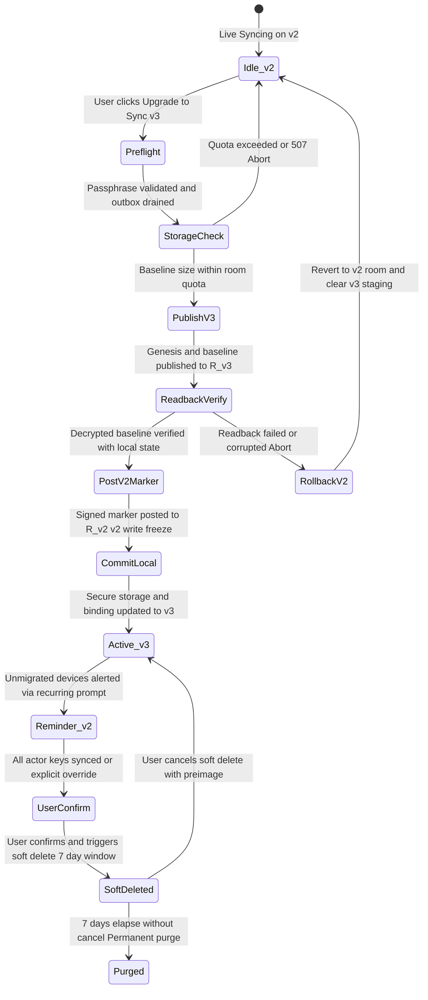

# Sync Key & Room Derivation v3: Migration & Hardening Design

> **Status:** Proposal / Design Specification (Design only — no application code implementation without owner approval)  
> **Target Release:** Cognate 3.2.0  
> **Related Architecture:** [docs/ARCHITECTURE.md](ARCHITECTURE.md), [docs/RELAY.md](RELAY.md), [docs/BENCHMARKS.md](BENCHMARKS.md)

---

## 1. Threat Model, Browser Context & Entropy Analysis

### 1.1 Vulnerability in Protocol v2 Key Derivation
In the current implementation (`src/services/crypto.ts`), `deriveSyncKey` uses static salt `'cognate-sync-key-v2'` and `deriveRoomId` uses static salt `'cognate-sync-room-v2'`. Because salts are global and hardcoded:
1. **Offline Multi-Target Dictionary Attacks**: An adversary obtaining a relay database snapshot can compute rainbow tables or run GPU dictionary attacks against all workspaces simultaneously.
2. **Deterministic Cross-Tenant Collisions**: Two independent users selecting the same passphrase derive the identical 32-character room ID on the relay.
3. **Residual Risk on Historical v2 Data**: Because v2 rooms are append-only journals without deletion endpoints, historical ciphertext remains on the relay indefinitely unless explicitly purged.

### 1.2 Entropy & Representation Table
Every workspace generates 128 bits of true cryptographic entropy ($S$) via CSPRNG (`crypto.getRandomValues(new Uint8Array(16))`).

| Representation | Format | Bits | Collision Probability ($N = 10^9$) | Offline Brute-Force ($10^{12}$ guesses/s) |
|---|---|---|---|---|
| **Raw Bytes** (QR / Recovery Kit) | 16 raw octets (`Uint8Array(16)`) | 128 | $P \approx \frac{N^2}{2^{129}} \approx \frac{10^{18}}{6.806 \times 10^{38}} \approx 1.47 \times 10^{-21}$ | $2^{128} \approx 3.403 \times 10^{38}$ attempts $\to 1.078 \times 10^{19}$ years |
| **Manual Code** (Crockford Base32) | 26 payload symbols + 1 check symbol | 128 | Same ($128$ bits entropy $+ 2$ zero pad bits) | Same ($1.078 \times 10^{19}$ years) |
| **Encrypted Recovery Kit** | 16 raw octets in `PasswordBlob` | 128 | Same | Same |

*Exact Arithmetic*:
- Collision probability by Birthday bound: $P(N) \approx 1 - \exp\left(-\frac{N^2}{2 \cdot 2^{128}}\right) \approx \frac{N^2}{2^{129}}$. For $N = 10^9$ workspaces: $\frac{(10^9)^2}{2 \times 3.4028 \times 10^{38}} = 1.469 \times 10^{-21}$.
- Brute-force time: $\frac{2^{128}}{10^{12} \text{ tries/s}} = \frac{3.4028 \times 10^{38}}{10^{12} \times 3.15576 \times 10^7 \text{ s/yr}} = 1.078 \times 10^{19}$ years.

### 1.3 Desktop (Tauri) vs. Browser Threat Model
Cognate runs primarily as a native Tauri desktop application, with optional mobile/browser support. The security boundaries differ significantly across environments:

| Environment | Secret Storage Mechanism | Threat Vectors | Mitigations |
|---|---|---|---|
| **Desktop (Tauri)** | OS Credential Vault via `keyring` (Apple Keychain, Windows Credential Manager, Secret Service) | Local non-elevated process compromise; OS memory dumping | Native OS process isolation; credential vault access restricted to Cognate binary identity |
| **Browser (Web)** | Encrypted IndexedDB (`browserVault` with WebCrypto) | Cross-Site Scripting (XSS) exfiltrating IndexedDB; malicious extensions; browser profile disk dumping | Strict CSP (`script-src 'self'`); no remote scripts/CDNs; ephemeral in-memory CryptoKeys (`extractable: false`); recommend desktop app for high-risk users |

### 1.4 Threat Mitigation Matrix

| Threat Vector | Protocol v2 (Current) | Protocol v3 (New Data) | Protocol v3 (Historical v2 Data) |
|---|---|---|---|
| **Relay DB Compromise (Dictionary Attack)** | High Risk: global static salt allows pre-computation / multi-target attacks | Fully Mitigated: 128-bit per-room setup salt renders rainbow tables impossible | Mitigated by v2 soft-delete & 7-day permanent purge (Section 6.5) |
| **Cross-Tenant Room Collision** | Medium Risk: identical passphrase produces identical room ID | Eliminated: $P < 1.47 \times 10^{-21}$ for $10^9$ workspaces | v2 room retains existing collision risk until purged |
| **Relay Traffic Eavesdropping** | Room ID leaked; allows targeted passphrase guessing | Room ID requires knowing both $P$ and $S$ | v2 room ID remains linkable until purged |
| **Shoulder Surfing / Display Capture** | Attacker sees passphrase | Attacker only sees QR / Setup Code $S$; still lacks $P$ | No impact |

---

## 2. Setup Code & Base-32 Checksum Specification

### 2.1 Alphabet & Permissive Decoding
- **Encoding Alphabet** (32 symbols): `0 1 2 3 4 5 6 7 8 9 A B C D E F G H J K M N P Q R S T V W X Y Z` (omits `I`, `L`, `O`, `U`).
- **Bit Packing**: 16 raw bytes (128 bits) are padded with two zero bits to 130 bits, yielding exactly 26 five-bit symbols ($26 \times 5 = 130$).
- **Decoding Rules**:
  - Case-insensitive (lowercase mapped to uppercase).
  - Hyphens (`-`) and spaces are ignored.
  - Permissive canonical alias mapping: `O` and `o` $\to$ `0`; `I`, `i`, `L`, `l` $\to$ `1`.
  - `U` and `u` are rejected during decoding to prevent accidental profanity.

### 2.2 CRC-5 Check Symbol (Polynomial $x^5 + x^2 + 1$)
The legacy position-weighted modulo-32 sum missed substitutions where the weight $(i + 1)$ shared a common factor with 32 (e.g. at weight 2, $\Delta = 16$ caused an undetectable collision). v3 replaces it with a **CRC-5** computed over the full **130 bits** (128 data bits + 2 zero pad bits), producing exactly one Crockford Base-32 check character.

- **Generator Polynomial**:
  $$P(x) = x^5 + x^2 + 1 \quad (\text{binary divisor } 100101_2 = \text{0x25}, \text{normal feedback } \text{0x05})$$
  $P(x)$ is primitive over $\text{GF}(2)$, providing maximal period $2^5 - 1 = 31$.
- **Input Bit Stream**:
  The 16 raw bytes (128 bits) are serialized MSB-to-LSB into a 130-bit sequence by appending 2 zero pad bits:
  $$b_0, b_1, \dots, b_{127}, b_{128} = 0, b_{129} = 0$$
  This matches the 26 Base-32 digits ($26 \times 5 = 130$ bits) where digit $d_{25}$ contains 3 data bits and 2 zero pad bits in its lowest two positions.
- **Canonical Representation & Pad Bit Validation**:
  Non-zero pad bits ($(d_{25} \mathbin{\&} \text{0x03}) \neq 0$) are strictly non-canonical and are rejected by the decoder prior to payload acceptance.
- **Error Detection Proof & Measurements**:
  - *Single-Character Substitutions*: Any single Base-32 symbol modification corresponds to an error polynomial $E(x) = e(x) \cdot x^k$ where $\deg(e) \le 4$. Because $P(x)$ is irreducible of degree 5, $\gcd(P(x), e(x)) = 1$. Consequently, $P(x)$ can never divide $E(x)$. Exhaustive testing across 1,000 random setup codes ($837{,}000$ single substitutions) achieved a measured detection rate of **100.00%** ($837{,}000 / 837{,}000$).
  - *Adjacent Transpositions*: Transposing distinct adjacent symbols $c_i \leftrightarrow c_{i+1}$ generates error polynomial $E(x) = (c_i \oplus c_{i+1}) x^{5k} (x^5 + 1)$. Because $x^5 + 1 = P(x) + x^2$, $(x^5 + 1)$ is not divisible by $P(x)$, and $(c_i \oplus c_{i+1})$ has degree $\le 4 < 5$. Measured detection rate across 1,000 random setup codes ($25{,}183$ transpositions) is **100.00%**.
- **Formatting**: 26 payload characters + 1 CRC-5 check character grouped as 6 groups of 4 plus 3: `XXXX-XXXX-XXXX-XXXX-XXXX-XXXX-XXX` (27 characters).

### 2.3 Worked Known-Answer Test Vectors

1. **Zero Vector** (16 bytes `0x00`):
   - Raw: `00000000000000000000000000000000`
   - Base32 Digits ($d_0 \dots d_{25}$): 26 zeros (`00000000000000000000000000`).
   - Arithmetic: 130 zero bits. $M(x) = 0$. $R(x) = 0 \pmod{P(x)} = 0 \to c = 0 \to$ check symbol `0`.
   - Formatted: `0000-0000-0000-0000-0000-0000-000`
2. **All-Ones Vector** (16 bytes `0xFF`):
   - Raw: `ffffffffffffffffffffffffffffffff`
   - Base32 Digits: $d_0 \dots d_{24} = 31$, $d_{25} = 28$ (`11100_2` = 28 = `W`). String: `ZZZZZZZZZZZZZZZZZZZZZZZZZW`.
   - Arithmetic: 128 one bits followed by 2 zero pad bits: $M(x) = \sum_{i=2}^{129} x^i = \frac{x^{130} + x^2}{x + 1}$.
   - Remainder modulo $P(x) = x^5 + x^2 + 1$:
     $$M(x) \equiv x^4 + x \equiv 10010_2 = 18 \pmod{P(x)}$$
   - Lookup: Index $18$ in Crockford alphabet (`0123456789ABCDEFGHJKMNPQRSTVWXYZ`) is `J`.
   - Formatted: `ZZZZ-ZZZZ-ZZZZ-ZZZZ-ZZZZ-ZZZZ-ZWJ`
3. **Sequential Vector** (16 bytes `0x01` through `0x10`):
   - Raw: `0102030405060708090a0b0c0d0e0f10`
   - Base32 Digits: `[0, 4, 1, 0, 6, 1, 0, 5, 0, 24, 3, 16, 16, 2, 8, 10, 1, 12, 6, 0, 26, 3, 16, 15, 2, 0]` (`041061050R3GG28A1C60T3GF20`).
   - Arithmetic: 130-bit polynomial divided by $P(x) = x^5 + x^2 + 1$:
     $$M(x) \equiv x^3 + x^2 + x \equiv 01110_2 = 14 \pmod{P(x)}$$
   - Lookup: Index $14$ in Crockford alphabet is `E`.
   - Formatted: `0410-6105-0R3G-G28A-1C60-T3GF-20E`

---

## 3. Key Derivation Architecture (Single PBKDF2 + HKDF-SHA256)

```text
Passphrase P (NFKD, trimmed, >= 12 scalar values)
         │
         ▼
PBKDF2-SHA256 (600,000 iters) ── Salt: "cognate-v3:" || 0x10 || SetupCode[16]
         │
         ▼
Master Secret M (256 bits PRK)
         │
         ├─► HKDF-Expand(info="cognate-sync-key-v3", 32) ──► K_v3 (AES-256-GCM)
         ├─► HKDF-Expand(info="cognate-sync-room-v3", 32) ─► R_v3 (First 32 hex chars)
         └─► HKDF-Expand(info="cognate-sync-verifier-v3", 16) ─► C_v3 (32 hex chars)
```

### 3.1 Derivation Parameters & Byte Encodings
- **Salt**: ASCII prefix `cognate-v3:` (11 bytes) $\mathbin{\Vert}$ length byte `0x10` (1 byte) $\mathbin{\Vert}$ raw 16-byte Setup Code $S$ = 28 octets total.
- **Master Secret ($M$)**: $\text{PBKDF2-SHA256}(P, \text{Salt}, 600000, 32 \text{ bytes})$.
- **HKDF-SHA256 Expansion**:
  - $K_{v3}$: $\text{HKDF-Expand}(M, \text{"cognate-sync-key-v3"}, 32) \to$ 256-bit AES-GCM `CryptoKey`.
  - Room ID $R_{v3}$: $\text{HKDF-Expand}(M, \text{"cognate-sync-room-v3"}, 32) \to$ first 16 bytes encoded as 32 lowercase hex characters.
  - Genesis Verifier $C_{v3}$: $\text{HKDF-Expand}(M, \text{"cognate-sync-verifier-v3"}, 16) \to$ 16 bytes encoded as 32 lowercase hex characters.

### 3.2 Performance Benchmarks
- **Measured Desktop Performance**: Benchmarked on 13th Gen Intel Core i7-13620H (Linux x86_64, Node WebCrypto): 600,000 iterations take **227.9 ms** median (range 210–248 ms across 5 runs). HKDF expansion takes $< 1$ ms.
- **Mobile Performance (Estimate)**: Low-to-mid tier mobile ARM cores (Cortex-A55) are estimated at 1.0–2.0 s.
- **Main Thread Isolation**: `crypto.subtle` executes PBKDF2 off the main JavaScript UI thread in Web Worker / browser thread pools, preventing UI freezes while displaying a spinner.

### 3.3 Known-Answer Test Vector (KAT)
- **Input Passphrase**: `correct horse battery staple`
- **Input Setup Code**: `0102030405060708090a0b0c0d0e0f10` (`0410-6105-0R3G-G28A-1C60-T3GF-20E`)
- **Derived Outputs**:
  - Master Secret ($M$): `64d28da6b43e213c1479ac959aa8761c20156c179b669514f7fa7b76c2ecf288`
  - AES Key ($K_{v3}$): `b9b73b7fb6a7389e1c94186de6f63d25ee217ff76e135678951af4947db15057`
  - Room ID ($R_{v3}$): `af340eac1d2451afe20f762a4a8cb695`
  - Genesis Verifier ($C_{v3}$): `3cf82af26a2bdad2b0e0aa78f6bb1166`
  - Sample AES-GCM Ciphertext (zero IV of 12 zero bytes, plaintext `{"genesis":true}`):
    - Ciphertext: `0e2209e87b9dcb2fa8d6ed3bc8aaa7be`
    - GCM Tag: `d8dc956bb905c44e6e95319a97953397`

---

## 4. Mandatory Passphrase Policy & Justification

### 4.1 Canonical Validation Policy
1. **Mandatory Requirement**: Passphrase is **strictly mandatory** for all v3 workspaces.
2. **Normalization**: Unicode Normalization Form KD (`NFKD`) applied before length checks, validation, and key derivation.
3. **Whitespace**: Leading and trailing whitespace is stripped via `trim()`; internal whitespace is preserved.
4. **Length**: Must contain at least 12 Unicode scalar values (`[...normalized].length >= 12`).
5. **Entropy & Common Passwords**:
   - Rejects single-character repeated strings ($\ge 4$ unique code points required).
   - Rejects exact matches against top 10,000 common passwords via a compact 25 KB Bloom filter / hash set.
6. **No Retroactive Invalidation**: Existing v2 workspaces continue syncing with short passphrases until migration. Migration to v3 requires updating any sub-12-character passphrase to $\ge 12$ scalar values before proceeding.

### 4.2 Security Justification: Two-Factor Confidentiality
The Setup Code is a **possession factor** (rendered on display as an alphanumeric Crockford Base32 string or printed).

> [!WARNING]
> **No QR Pairing**: QR code generation and camera scanning are **not implemented** in the application. Device pairing is performed exclusively by manually entering or copying the 27-character Setup Code alongside the passphrase.
> **Total Device Loss**: If a user loses every device without having recorded the Setup Code or exported an encrypted `.cognate-recovery` kit, workspace data cannot be recovered.

Requiring both factors prevents visual eavesdropping or partial credential exposure from compromising workspace read/write access.

---

## 5. Workspace Genesis vs. Join Semantics

To prevent an incorrect passphrase or setup code from silently creating and syncing to an empty room, workspace creation and workspace joining have distinct semantics.

### 5.1 Workspace Creation (Originating Device)
1. Derives $K_{v3}, R_{v3}, C_{v3}$ and generates a 128-bit random delete token $T_{del}$.
2. Compiles a signed `v: 3` genesis batch (Batch ID `genesis`, Cursor 1) containing:
   - Verifier ciphertext: AES-GCM encryption of `{"verifier": C_v3, "workspace_id": UUID}`.
   - Initial compact snapshot (squashed state of tasks, projects, actor identity, and HLC clock anchor).
3. Posts genesis batch to `PUT /v2/rooms/{R_v3}/batches/genesis` with registration header `X-Delete-Token-Hash: SHA-256(T_del)`.

### 5.2 Workspace Joining (Second Device)
When a user selects "Join Existing Workspace" on Device 2:
1. Inputs Relay URL, Setup Code $S$, and Passphrase $P$.
2. Computes candidate $K_{v3}', R_{v3}', C_{v3}'$.
3. Fetches genesis batch: `GET /v2/rooms/{R_v3}'/batches?after=0`.
4. **Validation Pipeline**:
   - **Step 1 (Existence)**: If room returns 0 batches (cursor 0), **fail immediately** with `"No workspace found for this Setup Code and Passphrase"`. Joining **never** auto-creates a room.
   - **Step 2 (Decryption)**: Decrypt batch 1 with candidate $K_{v3}'$. If GCM tag check fails, **fail immediately** with `"Incorrect Passphrase"`.
   - **Step 3 (Verifier Check)**: Verify decrypted `verifier === C_v3'`. If mismatch, **fail immediately**.
   - **Step 4 (Identity & Signature)**: Verify ECDSA signature of genesis batch against embedded creator public key.
5. Commit local sync configuration only after Steps 1–4 succeed.

---

## 6. Migration State Machine, Deletion & Rollback



### 6.1 Pre-flight, Publish & Readback Verification
1. Ensure local outbox is drained (no unacknowledged v2 batches).
2. Compute squashed snapshot baseline. Size is checked against `RELAY_ROOM_QUOTA` (8 MB). A squashed baseline is typically 50–200 KB, avoiding journal limit exhaustion.
3. Publish genesis and baseline batches to $R_{v3}$.
4. **Strict Verification Step**: Device fetches batches back from $R_{v3}$ via HTTP, decrypts with $K_{v3}$, and validates signatures. The migration does **not** proceed unless readback passes.

### 6.2 Migration Marker Contents & Privacy
Device writes a signed batch to $R_{v2}$ containing **ONLY**:
```json
{
  "migrated": true,
  "timestamp": 1793548800,
  "actor": "actor_pubkey_hex",
  "sig": "signature_hex"
}
```
**Critical Security Property**: The migration marker contains **NO v3 room ID ($R_{v3}$)**, **NO key material**, and **NO relay connection hints**. If an adversary breaks the weak v2 passphrase, reading the v2 marker reveals only that migration occurred; it does NOT reveal $R_{v3}$ or link the two rooms. Devices reading the marker know migration happened and prompt the user for the v3 passphrase and setup code.

### 6.3 Write-Freeze, Reminders & Explicit Confirmation
1. **v2 Write-Freeze**: Any client observing the migration marker in $R_{v2}$ enters read-only mode for v2 and refuses to post further v2 batches.
2. **Recurring Reminders**: Un-migrated devices alert the user with recurring notifications to pair the device by typing their passphrase and scanning the setup code.
3. **No Auto-Sunset**: The v2 room is **never automatically deleted** after 30 days.
4. **Explicit User Confirmation**: The v2 room is deleted ONLY after the user clicks an explicit button: `"Finish migration and delete legacy relay data"` in Settings.
   - The UI verifies that all known actor public keys from v2 have synced at least one batch to v3.
   - If an actor key has not synced, the user must check an explicit override: `"I understand un-synced devices may lose sync"`.

### 6.4 Server-Side Soft-Delete & 7-Day Purge Architecture
To eliminate vulnerable historical v2 ciphertext while protecting against accidental deletion:

#### 6.4.1 Legacy Room Claim Design Comparison
Existing v2 rooms created prior to delete-token support lack a registered delete-token hash. Three options were evaluated to enable legacy room deletion:
1. **Option (a) Claim-on-First-Request (Recommended & Implemented)**:
   - An unclaimed room accepts exactly one claim via `POST /v2/rooms/{room}/claim` with `{"delete_token_hash": "<64_hex_digits>"}` in the JSON body.
   - Once claimed, subsequent claims return `409 Conflict`.
   - Requests are rate-limited per IP and logged.
   - *Pros*: Preserves the "dumb relay" architecture without requiring user accounts or administrative intervention.
   - *Cons / Squatting Risk*: An adversary who cracks the weak v2 passphrase or discovers the room ID could race to register their own hash first.
   - *Implemented Mitigation*: The client claims every v2 room it syncs with on connect (when the relay advertises `claim_supported`), not only at migration time.
   - *Residual Risk*: If the v2 passphrase was already cracked prior to legitimate claim registration, treat that history as exposed; an attacker could race to claim or already possess copies of historical batches.
2. **Option (b) Operator-Only Admin Delete**:
   - Deletion is authorized exclusively by a separate `RELAY_ADMIN_TOKEN` held by the server operator.
   - *Pros*: Eliminates squatting by unauthenticated attackers.
   - *Cons*: Violates user privacy and self-service model; users cannot clean up their own legacy data without contacting the server administrator.
3. **Option (c) Hybrid Proposal (Client Claim + Operator Fallback)**:
   - Client claims on first sync/connect; if a token is lost or squatted, operator fallback via `RELAY_ADMIN_TOKEN` allows manual purge.

#### 6.4.2 Wire Rules & Uniform Responses
All token-bearing endpoints follow strict wire rules to eliminate URL token leaks and side-channel timing disclosures:
- **POST Only**: `delete`, `undelete`, `claim`, and `freeze` are strictly `POST` endpoints. HTTP `PUT` and `DELETE` aliases are removed.
- **Body Only**: Credentials (`delete_token` or `delete_token_hash`) must be passed in the JSON request body. Tokens in URL query parameters are rejected with `400 Bad Request`.
- **Constant-Time Comparison**: Hashes are verified using constant-time equality checks (`subtle::ConstantTimeEq`). When a room is not found or has no registered token, comparison runs against a dummy hash to maintain identical execution timing.
- **Uniform Unauthorized Response**: Unknown room, room with no registered token, and incorrect delete token return the exact same response: `403 Forbidden` with body `{"error": "unauthorized"}`.
- **IP Rate Limiting**: Failed token attempts are tracked and rate-limited per client IP (10 failed attempts per 60-second window before returning `429 Too Many Requests`).

#### 6.4.3 Relay Capability Advertisement
The relay advertises its supported features and quotas via `GET /v2/capabilities` and `GET /health`:
- **Payload**:
  ```json
  {
    "ok": true,
    "protocol": 2,
    "relay_version": "0.2.0",
    "delete_supported": true,
    "claim_supported": true,
    "freeze_supported": true,
    "max_body": 1048576,
    "room_quota": 8388608,
    "max_store": 33554432
  }
  ```
- **Dynamic Client Quotas**: Clients query `/v2/capabilities` on connect and enforce `room_quota` dynamically rather than hardcoding 8 MB.
- **Old Relay Detection**: A missing capabilities endpoint (or 404) indicates a legacy relay.
- **Old Relay UX**: If the relay does not advertise `delete_supported`, the client UI displays `"This relay cannot delete history"`, hides the delete button, and never fails silently.

#### 6.4.4 Server-Side Write Freeze
To prevent split-brain forks when migrating devices upgrade:
- `POST /v2/rooms/{room}/freeze` authorizes with `{"delete_token": "<token>"}` in the JSON body.
- When frozen, subsequent batch `PUT` requests return `409 Conflict` (`{"error": "room is frozen"}`).
- Batch `GET` requests continue to work, allowing stale devices to pull historical batches and observe the migration marker.
- **Sequencing**: The migrating device invokes server-side freeze only after v3 readback verification succeeds.
- **Old Relay Fallback**: Without relay support (`!caps.freeze_supported`), write-freeze is client-side only (`sync_v2_write_frozen`), meaning stale un-migrated devices could theoretically continue writing until upgraded.

#### 6.4.5 Delete Token Loss & Operator Wipe
If the client loses the delete token $T_{del}$, legacy history cannot be deleted or soft-deleted via client APIs. The relay rejects unauthenticated delete requests uniformly with `403 Forbidden` (`{"error": "unauthorized"}`). In this scenario, a manual operator database wipe on the relay server is the only remaining path to eliminate historical v2 data.

---

## 7. Decisions Implemented from Owner Review

1. **Decision D1 (Server-Side Room Deletion)**: Implemented Option A (preimage delete token) with 7-day purge window and undelete support. Replaces immutable journal non-goal to eradicate historical v2 vulnerability.
2. **Decision D2 (Sunset Policy)**: Replaced 30-day automatic sunset with write-freeze, recurring reminders, and mandatory explicit user confirmation requiring all actor keys synced (or override).
3. **Decision D3 (Passphrase Policy)**: Passphrase is strictly mandatory ($\ge 12$ Unicode scalar values), ensuring two-factor confidentiality alongside the 128-bit Setup Code.

---

## 8. Test Plan

1. **Base-32 Checksum Encoding & Verification**:
   - Verify encoding and position-weighted mod-32 checksums for zero vector, all-ones vector, and sequential vector (Section 2.3).
   - Verify 100% detection of adjacent symbol swaps.
   - Verify permissive decoding (case-insensitive, strip hyphens/spaces, alias `O` $\to$ `0`, `I`/`L` $\to$ `1`, reject `U`).
2. **KDF & KAT Vectors**:
   - Verify KAT vectors from Section 3.3 for Master Secret, $K_{v3}$, $R_{v3}$, $C_{v3}$, and AES-GCM tag.
3. **Genesis vs. Join Semantics**:
   - Joining non-existent room fails with `"No workspace found"` without creating a room.
   - Wrong passphrase produces GCM tag verification error.
   - Verifier mismatch error on corrupted genesis batch.
4. **Migration & State Machine**:
   - Pre-flight aborts on 507 quota error without writing to v2 room.
   - Readback verification failure triggers rollback before v2 marker is written.
   - Migration marker contains ONLY `{ migrated: true, timestamp, actor, sig }` (no $R_{v3}$ or relay hints).
   - v2 write-freeze blocks subsequent v2 writes.
   - Explicit user confirmation gate verifies actor keys before triggering soft-delete.
   - Soft-delete 7-day grace window allows cancellation with delete token preimage.
